# How the Two Systems Work: Worklist and Source Simulator

A plain-language guide to the reconciliation POC: what each of the two applications does, how they talk to each other, and how to use them, step by step.

**Who this is for:**
- shift supervisors, planners and managers who use the **worklist**;
- the operator who drives the **source simulator** during a demo or a test;
- anyone who wants to understand what happens between them.

You don't need to know Python or databases to follow it.

**Everything in the simulation is invented.** SKUs are numbered 9001xx, and every item and customer name starts with "SIM". No plant data is used, and nothing here changes a real MIPS, WMS or Oracle system.

---

## Contents

1. [The idea in one minute](#1-the-idea-in-one-minute)
2. [Open the two systems](#2-open-the-two-systems)
3. [The big picture](#3-the-big-picture)
4. [System A: the worklist](#4-system-a-the-worklist)
5. [System B: the source simulator](#5-system-b-the-source-simulator)
6. [How one change travels from B to A](#6-how-one-change-travels-from-b-to-a)
7. [The starting day](#7-the-starting-day)
8. [The eight scenarios](#8-the-eight-scenarios)
9. [Guided walkthroughs](#9-guided-walkthroughs)
10. [The rules in plain words](#10-the-rules-in-plain-words)
11. [Start, stop and reset](#11-start-stop-and-reset)
12. [Troubleshooting](#12-troubleshooting)
13. [Glossary](#13-glossary)

---

## 1. The idea in one minute

At the bakery, three systems describe the same bread:

- **MIPS** plans what to make.
- **ODI / Oracle** records what was made.
- **WMS** runs the warehouse and ships to customers.

They often disagree. Today people find the disagreements by comparing screens by hand.

The **worklist** (System A) does that comparison automatically. It lists every disagreement as a *flag*, says which system is wrong and what to do, and lets supervisors and planners act on it.

To see how the worklist behaves when data changes *during a shift*, we need data that changes. We don't have live connections to the plant's systems yet. So the **source simulator** (System B) plays the part of MIPS, ODI, WMS and Oracle. An operator changes their data, plays a scripted problem, or makes the connection between the systems misbehave, and watches the worklist react within a second.

Think of it as a flight simulator: the cockpit (the worklist) is the real one, and the world outside the window (the plant's systems) is simulated.

---

## 2. Open the two systems

On this machine both systems run in Docker and start on their own when Docker Desktop starts.

| System | Address | Who uses it |
|---|---|---|
| **A: Worklist** | http://localhost:8001/ | Supervisors, planners, managers |
| **B: Source simulator** | http://localhost:8101/ | The operator running the demo or test |

Open them side by side, for example the worklist on the left half of the screen and the simulator on the right. That way you see a change and its effect at the same time.

### Sign in to the worklist

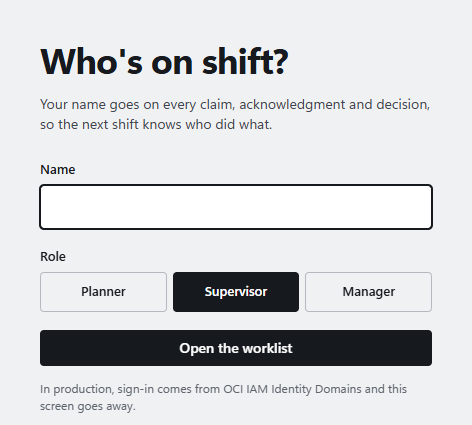

1. Type your username and password. The administrator creates accounts; for a demo, use the demo accounts (`planner1`, `planner2`, `supervisor1`, `supervisor2`, `manager1`).
2. Click **Open the worklist**.

Your role (**Planner**, **Supervisor** or **Manager**) comes with your account. Only planners and managers can approve a correction (section 4.6). Your account's name goes on every claim, acknowledgment and decision you make.

### Sign in to the simulator

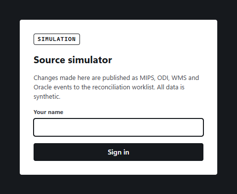

Sign in with the same username and password as the worklist. Your account's name appears on every change you make.

> The simulator is for demos and testing only. It never runs next to a production worklist.

---

## 3. The big picture

```
   SYSTEM B: SOURCE SIMULATOR                                  SYSTEM A: WORKLIST
   (plays MIPS, ODI, WMS, Oracle)                              (what supervisors use)

   Operator edits a row,                                       Flags appear, change
   or runs a scenario                                          or disappear
          │                                                           ▲
          ▼                                                           │
   ┌──────────────┐    ┌─────────────────┐    ┌──────────────┐   ┌──────────┐
   │ Source        │──▶│ Integration      │──▶│ Event log     │──▶│ Rules     │
   │ systems' data │    │ (can be slowed, │    │ (what the     │   │ engine    │
   │ (the truth)   │    │  broken, etc.)  │    │  worklist     │   └──────────┘
   └──────────────┘    └─────────────────┘    │  receives)    │
          ▲                                     └──────────────┘
          │                                                           │
          └──────────── approved corrections (write-back) ◀───────────┘
```

**Source systems' data.** The simulator keeps the "true" rows of each system: order lines, production runs, warehouse orders, receipt tickets, transactions and Oracle postings.

**Integration.** In the real plant, tools such as Oracle GoldenGate and Oracle Integration carry changes from each system to the worklist. In the simulator you can deliberately make this connection late, lossy, repetitive or out of order, to see how the worklist copes (section 5.5).

**Event log.** Every change that reaches the worklist is written here in order, with a number (event #1, #2 …). It's the only thing the two systems share.

**Rules engine.** Inside the worklist, 19 rules compare the systems and raise flags (section 10). Rules compute every number. The AI only writes explanations, never quantities.

**Write-back.** When a planner approves a proposed fix on the worklist, it travels back to the simulator, which plays Oracle Integration. The source data changes, and that change travels forward again like any other. The worklist only calls the fix *confirmed* when it sees the change arrive.

---

## 4. System A: the worklist

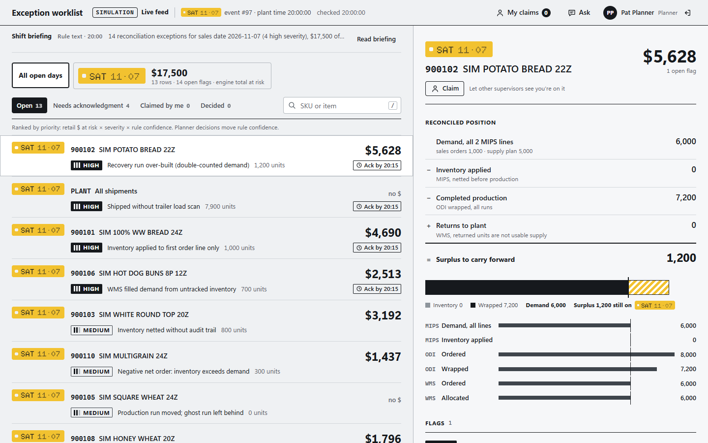

### 4.1 The screen at a glance

| Area | What it shows |
|---|---|
| **Top bar** | **SIMULATION / Live feed** tells you the data comes from the simulator, not the daily Excel files. Next to it: the sales day, the last event the worklist has processed (e.g. *event #97*) and the **plant time**. On the right: your claims, the **Ask** assistant and your name. |
| **Shift briefing** | A short summary of the situation. It starts as rule text, and an AI-written version replaces it a little later (section 4.7). Click **Read briefing** for the full text and the top actions. |
| **Sales-day tiles** | One tile per open sales day, with the number of rows, flags and dollars at risk. |
| **View tabs** | **Open**, **Needs acknowledgment**, **Claimed by me**, **Decided**. |
| **Queue (left)** | One row per SKU with problems (or per plant-level problem), most expensive first. Each row shows severity, the top problem, units and dollars. |
| **Detail (right)** | The selected row in full: the reconciled position, every flag, the evidence, and the decision buttons. |

> **Plant time vs. your clock.** The simulation has its own clock, which starts at 20:00 on the evening before the sales day. Deadlines such as "acknowledge by 20:15" follow plant time, which the simulator operator can speed up.

### 4.2 Reading a flag

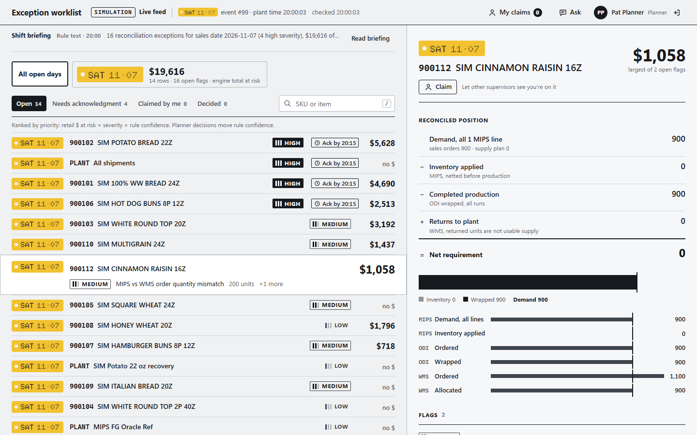

Each flag tells you:

- **Severity and rule.** High, Medium or Low, and the rule code (R01–R19). Severity is shown by a label and bars, never by colour alone.
- **Units and dollars.** The quantity involved and its retail value at risk.
- **Explanation.** What is wrong, in which system, and what to do. It's labelled *Rule text* or *AI explanation*.
- **Owner and scenario.** Who should act (e.g. *IT / Integration*, *Warehouse / WMS*) and which known problem this is.
- **System accountability.** Which system caused the problem, and what each of the three systems did (see below).
- **Evidence.** The actual values from each system that triggered the rule.

#### System accountability

Every flag says where the problem started and what it does to the business. The rules work this out from the same numbers as the flag, so it is there with or without the AI, and the AI cannot change it.

| Item | What it tells you |
|---|---|
| **Impact** | The effect on the business: *Over-production*, *Under-production*, *Stranded surplus* (made but not carried forward), *Short shipment*, *Overstated inventory*, *Traceability gap*, *Financial posting gap* (Oracle doesn't have it), or *Data integrity*. |
| **Started in** | The system where the error started. *Integration* means the fault is in the connection between two systems; the connection is named next to it, e.g. *WMS → Oracle*. |
| **Failure** | How it misfired, e.g. *Planning logic*, *Stale data*, *Missing transaction*, *Master data*. |
| **Attribution** | How sure the rules are. *Certain*: the data proves it. *Likely*: the usual cause, but another is possible, so check the record the AI names under *Confirm with*. *Undetermined*: the data can't say which system is wrong. |

Under it, each system gets one line: **MIPS**, **ODI** and **WMS** always, and **Oracle** when it's involved.

| Role | Meaning |
|---|---|
| **Misfired** (filled label) | The error started here. |
| **Affected** (outlined) | Holds or acts on a wrong value because of it. |
| **Conflicting** (outlined) | Disagrees with another system, and the data can't say which one is wrong. |
| **Reference** | Holds the value the others should match. |
| **To check** | The rule can't see this system, but it may carry the error. |
| **Not involved** | Plays no part in this error. |

For example, when a customer raises an order in WMS after MIPS last synced (R09), the flag reads: *Under-production · started in MIPS (WMS → MIPS) · Stale data · Likely*, with MIPS *Misfired* ("Still plans 3,500; WMS has 3,700 on order"), ODI *Affected* and WMS *Reference*.

Above the flags, the **reconciled position** is the bakery's core equation for the SKU:

```
  Demand (all MIPS lines)
− Inventory applied
− Completed production (ODI wrapped)
+ Returns to plant (WMS)
= Still to produce   (or, if negative, Surplus to carry forward)
```

The bar and the systems table under it show MIPS, ODI and WMS quantities on one scale, so a mismatch is visible at a glance. The bar draws the same equation, so returned units are left out of usable supply.

*Inventory applied* is worked out, not read: MIPS does not record it. It is the demand when the first production run was ordered, less what that run ordered. If demand changes afterwards (a new order, a line raised or cut in MIPS), that change is new demand: it moves "still to produce" or "surplus" by the same amount, and the demand line says so ("+1,200 since production was ordered"). If MIPS re-sends the first run, the agent takes the demand at that moment. A return counts once, whether WMS booked it as a return transaction, on the ticket, or both.

### 4.3 What you do with a flag

| Action | When | How |
|---|---|---|
| **Claim** | You're working on this SKU and want others to know | Open the row, click **Claim**. Your initials show in the queue. |
| **Acknowledge** | A High flag must be acknowledged within 15 plant minutes | Click **Acknowledge** on the flag. Overdue flags turn dark. |
| **Accept** | The flag is right | Add a note for the next shift if useful, then click **Accept**. |
| **Reject** | The flag is wrong | Click **Reject**. The rule's confidence drops a little, and the flag stays hidden while its quantity is unchanged. |
| **Approve and send** | There's a proposed correction and you're a planner or manager | See section 4.6. |
| **Ask** | You have a question ("why is MIPS asking for more 900112?") | Click **Ask** in the top bar and type it. |

### 4.4 How the worklist stays current

The worklist checks the event log twice a second. When something changes:

1. It re-runs all the rules (in well under a second).
2. It tells every open screen at once, without a page refresh. The top bar shows:

   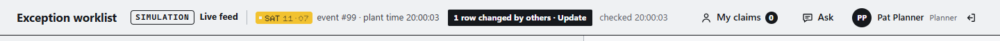

3. Click **N rows changed by others · Update** to bring the new rows in.

The list doesn't rearrange itself while you read it: rows only move when you click **Update**. This is on purpose. A supervisor in the middle of a decision shouldn't have the row jump away.

> **Before you decide, update.** If the black "changed" button is showing, click it first. Otherwise you may decide on old numbers.

When a problem is fixed at the source, its flag simply disappears after the update, because the systems now agree.

### 4.5 When the integration is slow or broken

The worklist only knows what reaches it. If the simulator operator delays or drops changes (section 5.5), the worklist shows the *last data it received*. The top bar's event number tells you exactly how current that is. This is the same situation as a real stale screen at the plant, and it's what the POC is designed to make visible.

### 4.6 Write-back: fixing the source from the worklist

For some flags, the fix is one clear change to one row in one system. For those, the flag shows a **proposed correction**:

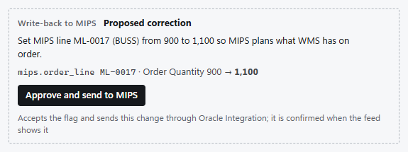

| Rule | Proposed correction |
|---|---|
| R09: MIPS and WMS order quantities differ | MIPS follows WMS: its main sales-order line takes the difference |
| R13: WMS order header disagrees with its item lines | Rebuild the order header from the item lines |
| R16: ODI's copy of the order quantity is behind MIPS | Re-send the quantity to ODI |
| R18: a WMS transaction never posted in Oracle | Resubmit (or create) the Oracle posting |
| R19: a return to plant isn't booked on the ticket | Book the returned quantity on the ticket |

Some flags never get an automatic correction, because the fix needs a fact only a person can confirm. Examples: where netted inventory physically is (R02), which day takes a surplus (R05/R06), which freezer lot was used (R07). For those, accept the flag and make the change yourself.

**To approve** (planners and managers only; supervisors see "A planner or manager approves write-back"):

1. Read the proposed change: which system, which row, old value → new value.
2. Click **Approve and send to (system)**. This also accepts the flag.

The correction then moves through these states, shown on the flag with times and names:

| State | Meaning |
|---|---|
| **Approved, sending** | You approved it; it is being sent. |
| **Sent, waiting for the change in the feed** | Oracle Integration (the simulator) accepted it. The worklist is waiting to *see* the change arrive. |
| **Confirmed in the feed** | The corrected values arrived through the normal feed. Usually the flag disappears at the same moment, because the systems now agree. |
| **Failed** | Integration was unavailable or rejected it, or the row had changed since the proposal was made. Click **Retry**: the proposal is recomputed from the current data. |
| **Cancelled** | On retry, no correction was needed any more. |

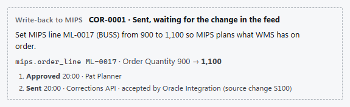

**Why "Sent" isn't enough.** An integration can say "yes" and still lose or delay the change. The worklist only trusts what it sees arrive.

**A fix can reveal the next problem.** For example, after MIPS raises an order line (R09), ODI's copy of that quantity is behind, so R16 may appear next. That's correct, and it's the kind of chain reaction the simulation is meant to show.

### 4.7 AI explanations

The worklist first shows rule-written text, so it's usable immediately. In the background it asks the AI model (Gemini on Oracle Cloud) to write clearer explanations and the shift briefing. When they're ready, the top bar shows **AI explanations ready · Reload**.

An AI explanation adds a box under the system accountability:

- **How it happened.** The chain of events in order, one system per step, starting where the error started. For example: *MIPS* ordered 2,000 on the recovery run when 800 were still needed, then *ODI* built it and wrapped 7,200 against 6,000 demand, so *WMS* receives 1,200 surplus units.
- **Impact.** The business effect, with its units and dollars.
- **Confirm with.** The one source record that proves the attribution, e.g. a MIPS line, an ODI run, a WMS ticket or an Oracle posting.
- **Linked flags.** Other flags with the same cause, e.g. R09 and R10 on the same SKU.

**Checking the AI.** Before an explanation is shown, every number in it is compared with the engine's numbers. If they all match, the box says *All 7 figures match the engine's data*. If the AI wrote a number the engine never produced, the box says so in bold (*1 figure not in the engine's data: 1,350. Check before acting.*). Treat that number as wrong. If the AI's chain of events starts in a different system from the one the rules name, the box says that too. The rules' answer is the one shown under *Started in*.

**Audit trail.** Every AI explanation, briefing and assistant answer shows an **Audit** number (e.g. `db427ab6e4f8`) and the time it was written. That number finds the full record in the AI audit log (`ai_audit.jsonl`, next to the decisions file): what the AI was sent, what it answered, the checks, and for the assistant who asked and what it looked up. If the log can't be written, the AI text isn't shown and the rule text stays.

The expanded shift briefing ends with **Where today's flags started**: flags, High flags, units and dollars at risk for each system. It's the system-level view of which system caused today's exceptions.

To keep costs and noise down, the worklist doesn't ask the AI after every change:
- It waits until the data has been quiet for 20 seconds (2 minutes at most).
- It only asks about flags it hasn't explained before.

Until then, new flags show rule text. That's normal.

---

## 5. System B: the source simulator

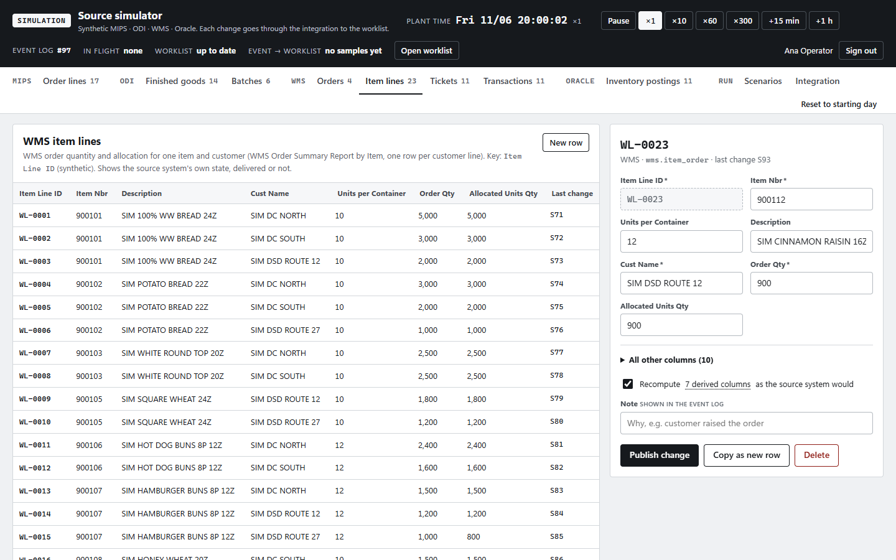

### 5.1 The top bar

| Item | Meaning |
|---|---|
| **Plant time** | The simulation clock, ticking live. Buttons: **Pause/Resume**, speed **×1 ×10 ×60 ×300** (×60 means one real second is one plant minute), **+15 min**, **+1 h**. |
| **Event log #** | The last event delivered to the worklist. |
| **In flight** | Changes the integration is holding back: delayed, held, or dropped. "none" means everything has been delivered. |
| **Worklist** | *up to date*: it has processed everything. *N behind*: it's catching up. *not reading*: the worklist isn't running. |
| **Event → worklist** | How long the worklist takes to process a change once it arrives (typically a fraction of a second). |
| **Open worklist** | Opens System A in a new tab. |

### 5.2 The tabs

| Group | Tab | What's in it |
|---|---|---|
| MIPS | Order lines | Sales orders (BUSS) and supply-plan lines (OCloud) per SKU and sales day |
| ODI | Finished goods | What each production run was ordered to make and actually wrapped |
| ODI | Batches | Dough batches mixed per formula |
| WMS | Orders | Customer order headers: ordered, allocated, loaded, shipped |
| WMS | Item lines | The same orders, broken down by item |
| WMS | Tickets | Receipts of finished goods from the plant into the warehouse |
| WMS | Transactions | Receipts, shipments, returns to plant, freezer moves |
| ORACLE | Inventory postings | Oracle's record of each WMS transaction (posted, or in error) |
| RUN | Scenarios | The eight scripted problems (section 8) |
| RUN | Integration | Faults between the systems and the worklist (section 5.5) |

The tables show the **source systems' own data**, the truth, whether or not it has reached the worklist yet. Rows changed recently are marked **CHANGED**.

### 5.3 Changing a row

1. Click a row's key (e.g. `WL-0023`). The editor opens on the right. The most important columns are shown first; **All other columns** has the rest.
2. Change a value, for example **Order Qty** from 900 to 1,100.
3. Optionally type a **Note** ("customer raised the order"). It appears in the change list.
4. Click **Publish change**.

Things worth knowing:

- **Derived columns update themselves.** With *Recompute derived columns* ticked, the simulator fills in the columns the real system would calculate, and marks them *auto*. For example, it updates expected ending inventory when wrapped units change, stacks, trays and completion status when allocation changes, and MIPS's "last modified" time. Untick the box to set them by hand (for example, to simulate a system bug).
- **Copy as new row** creates a variant with the next free key, e.g. a second production run.
- **Delete** removes the row from the source system.
- **Rebuild totals from item lines** (WMS orders only) makes the order header match its lines.
- If someone else changed the same row after you opened it, your save is refused and the latest values are shown. Make your change again.

### 5.4 The change list ("Source changes")

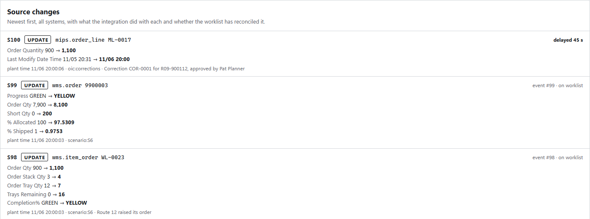

Every change made in any system appears here, newest first, with:
- what changed (old value → **new value**);
- who made it: an operator, a scenario, or `oic:corrections` for an approved write-back;
- the note;
- what happened to it on the way to the worklist.

| Label | Meaning |
|---|---|
| **event #98 · on worklist** | Delivered as event 98, and the worklist has processed it |
| **delayed 45 s** | Held back by a delay fault; it arrives later |
| **held for reorder** | Waiting so it can be delivered out of order |
| **dropped** | Lost on the way (it can be replayed) |
| **copy event #105** | A duplicate delivery; the worklist ignores it |

### 5.5 The Integration tab: making the connection misbehave

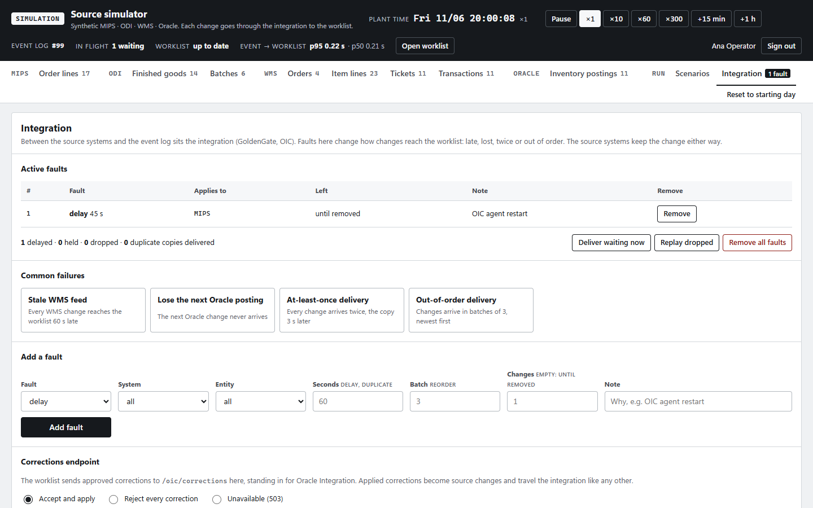

Real integrations fail in a few typical ways. You can switch each one on and off:

| Preset | What happens | What you should see on the worklist |
|---|---|---|
| **Stale WMS feed** | Every WMS change arrives 60 s late | WMS numbers lag behind; mismatches appear and then clear when the changes land |
| **Lose the next Oracle posting** | One Oracle change never arrives | The worklist believes a WMS transaction was never posted; after 10 plant minutes **R18** appears |
| **At-least-once delivery** | Every change arrives twice | Nothing at all: the worklist recognises and ignores the copy |
| **Out-of-order delivery** | Changes arrive in batches of 3, newest first | Nothing wrong: the worklist never lets an older value overwrite a newer one |

**Add a fault** builds your own. Pick the fault type, which system and/or table it affects, the seconds (delay, duplicate), the batch size (reorder), and how many changes it affects (empty means until removed).

**Buttons:**
- **Deliver waiting now** releases everything delayed or held.
- **Replay dropped** re-sends lost changes from the source, in order.
- **Remove all faults** turns everything off and delivers what was held.

The **Integration** tab shows a badge with the number of active faults, so you can't forget one is on.

**Corrections endpoint.** This is where approved write-backs arrive. Set it to one of:
- **Accept and apply:** normal.
- **Reject every correction:** the worklist shows *Failed*.
- **Unavailable (503):** the worklist shows *Failed*; retry once it's back.

### 5.6 The Scenarios tab

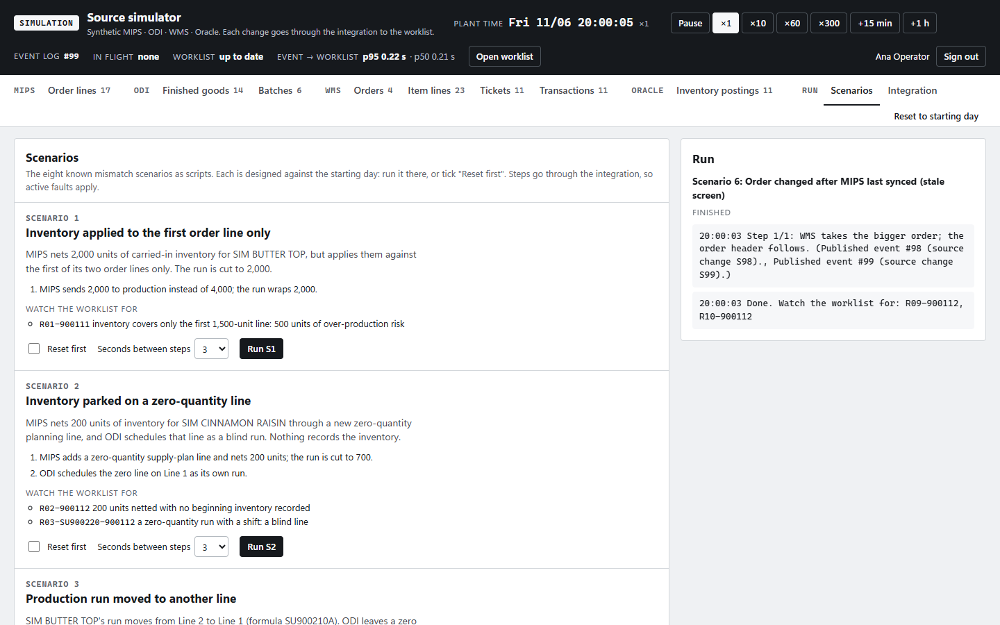

Each card describes one of the eight known problems (section 8): the story, its steps, and the flags to watch for. To run one:

1. Tick **Reset first** if you've already changed data. The scenarios are designed against the untouched starting day.
2. Choose **Seconds between steps** (3 is good for watching; 0 for speed).
3. Click **Run**. The run log on the right shows each step as it lands.

Scenario steps go through the integration like any other change, so an active fault affects them too. That's how you test "what if this problem happens *and* WMS is lagging?".

### 5.7 Reset to starting day

**Reset to starting day** (top right) clears every change, fault and delivery, and loads the starting day again. Open worklists start over automatically. It affects everyone using the simulator, so warn others first.

---

## 6. How one change travels from B to A

Take the operator raising Route 12's order for SIM CINNAMON RAISIN from 900 to 1,100:

| # | Where | What happens | Typical time |
|---|---|---|---|
| 1 | Simulator | The operator clicks **Publish change**. WMS's data now says 1,100: this is source change S98. | instant |
| 2 | Integration | With no faults, it's delivered straight away as event #98. A fault would hold, drop, repeat or reorder it here. | instant |
| 3 | Worklist | It notices event #98 within half a second and re-runs every rule. | < 1 s |
| 4 | Worklist | WMS now has 200 more on order than MIPS planned: **R09** and **R10** appear for SKU 900112. Open screens are told immediately. | < 1 s |
| 5 | Worklist | The supervisor sees "rows changed by others · Update" and clicks it. | when they look |
| 6 | Simulator | The change list shows "event #98 · on worklist". The status bar shows the worklist is up to date. | ~2 s (the simulator refreshes every 2 s) |
| 7 | Worklist | About 20 s after things go quiet, the AI writes the explanation for the new flags. | ~20 s + model time |

With write-back, a planner approves the proposed fix (MIPS line ML-0017 from 900 to 1,100), and the same path runs in reverse and forwards again:

worklist → simulator's Oracle Integration stand-in → MIPS data changes → integration → event log → worklist sees it → **Confirmed**, and R09 disappears.

---

## 7. The starting day

The starting day is one Saturday sales day (Sat 07 Nov 2026). Plant time starts at 20:00 on the Friday evening: production has finished, and the warehouse is loading trailers.

It holds 12 invented SKUs and 4 invented customers. Ten SKUs each carry one known problem, and two are clean so the scenarios can break them live:

| SKU | Item | What's wrong | Flag |
|---|---|---|---|
| 900101 | SIM 100% WW BREAD 24Z | Inventory applied to the first of three order lines only | R01 (High) |
| 900102 | SIM POTATO BREAD 22Z | A recovery run made 1,200 too many | R05 (High) |
| 900103 | SIM WHITE ROUND TOP 20Z | 800 units of inventory netted with no record of it | R02 |
| 900104 | SIM WHITE ROUND TOP 2P 40Z | A zero-quantity "blind" production line | R03 |
| 900105 | SIM SQUARE WHEAT 24Z | A run moved to Line 2; a ghost copy stayed on Line 1 | R04 |
| 900106 | SIM HOT DOG BUNS 8P 12Z | WMS shipped 700 units MIPS can't see (freezer stock) | R07 (High) |
| 900107 | SIM HAMBURGER BUNS 8P 12Z | A customer raised the order in WMS after MIPS synced; allocation is short | R09, R10 |
| 900108 | SIM HONEY WHEAT 20Z | 400 surplus not carried to the next day | R06 |
| 900109 | SIM ITALIAN BREAD 20Z | 10 per tray in MIPS, 12 in WMS | R11 |
| 900110 | SIM MULTIGRAIN 24Z | Inventory already exceeds demand | R08 |
| 900111 | SIM BUTTER TOP 20Z | Clean | none |
| 900112 | SIM CINNAMON RAISIN 16Z | Clean | none |
| *plant* | | One route shipped with no trailer load scan; a recovery batch mixed above plan; BUSS pads SKU codes with a space | R12 (High), R14, R15 |

So a fresh worklist shows **13 rows** (10 SKUs and 3 plant-level rows) with **14 flags**.

---

## 8. The eight scenarios

Each scenario plays one of the eight problems from the requirement brief, live, mostly on the two clean SKUs.

| Run | Problem | What happens in the simulated plant | Watch the worklist for |
|---|---|---|---|
| **S1** | Inventory applied to one line only | MIPS nets 2,000 units of carried-in inventory for 900111 against only the first of its two order lines | **R01**-900111 |
| **S2** | Inventory on a zero-quantity line | 200 units netted for 900112 through a new zero-quantity line, which ODI then schedules as a blind run | **R02**-900112, **R03** |
| **S3** | A run moved to another line | 900111's run moves from Line 2 to Line 1; a zero copy stays behind | **R04**-SU900210-900111 |
| **S4** | A recovery run double-counts | 900112 wraps 100 short; 90 plant minutes later a recovery run makes the full 900 again | **R05**-900112 (an R07 shows briefly in between) |
| **S5** | A return doesn't reduce the received quantity | 120 damaged units of 900111 go back to the plant, but ticket TK-0010 still shows 4,000 received | **R19**-TK-0010, **R07**-900111 |
| **S6** | Stale screen: order changed after MIPS synced | Route 12 raises 900112 from 900 to 1,100 in WMS; MIPS still plans 900 | **R09**-900112, **R10**-900112 |
| **S7** | Freezer stock not deducted | 300 more 900111 shipped from the freezer; MIPS plans them, but the plant makes nothing extra | **R07**-900111 |
| **S8** | WMS transactions missing in Oracle | A trailer ships; Oracle rejects one posting and never receives another | **R18** for two transactions, after 10 plant minutes |

---

## 9. Guided walkthroughs

Each walkthrough takes 2–5 minutes. Start each one with **Reset to starting day** in the simulator, and keep the worklist open beside it.

### A. See a problem appear live (S6)

1. **Simulator → Scenarios → S6**, Seconds between steps **3**, click **Run S6**.
2. **Worklist:** within a second the top bar shows "2 rows changed by others · Update". Click it.
3. Open **900112 SIM CINNAMON RAISIN 16Z**. Read **R09** (WMS has 200 more on order than MIPS planned) and **R10** (WMS is 200 short).
4. **Simulator:** the change list shows the two WMS changes as *on worklist*.

### B. Fix it from the worklist (write-back)

*Continue from A. You need to be signed in to the worklist as a Planner or Manager.*

1. On **R09-900112**, read the proposed correction: *Set MIPS line ML-0017 from 900 to 1,100*.
2. Click **Approve and send to MIPS**.
3. The flag disappears, because MIPS and WMS now agree. The correction is *Confirmed*.
4. **Simulator:** the change list shows S100 on `mips.order_line ML-0017`, made by `oic:corrections`, with your name in the note.
5. **Worklist:** two new flags appear on 900112. This is the knock-on effect of the fix:
   - **R16:** ODI's copy of the order quantity (900) is behind MIPS (1,100). It has its own proposed correction.
   - **R02:** MIPS now needs 1,100, but production was ordered 900, so the rules read the 200 gap as inventory that nobody recorded. There is deliberately no automatic correction: a person must decide whether the 200 units exist or must still be made.

### C. A slow integration holds a correction at "Sent"

1. Run **S6** again with **Reset first**.
2. **Simulator → Integration → Add a fault:** Fault **delay**, System **MIPS**, Seconds **45**. Click **Add fault**.
3. **Worklist:** approve the R09 correction. It stops at **Sent, waiting for the change in the feed**, and R09 stays. Oracle Integration said yes, but the change hasn't arrived.
4. **Simulator:** the change list shows the correction as *delayed 45 s*, and the top bar shows *In flight: 1 waiting*.
5. Wait 45 seconds, or click **Deliver waiting now**. The worklist then marks the correction **Confirmed** and R09 disappears.
6. Click **Remove all faults** when done.

### D. A posting goes missing in Oracle (S8, R18)

1. **Simulator → Scenarios → S8**, Seconds between steps **10**, **Run**.
2. **Worklist**, during the first two steps: the shipments and four Oracle postings arrive, but no flag appears. A posting only counts as late after **10 plant minutes**.
3. The scenario's last step moves the plant clock forward. **Two R18 flags** (High) appear on the worklist, even though no new data arrived. Time alone raised them.
4. One shipment was rejected by Oracle ("Lot not found"); the other never arrived. Each flag proposes to resubmit the posting to Oracle. Approve one and watch it clear.

> To see the time trigger on its own: in the **Transactions** tab, open any transaction and click **Copy as new row**. Give it a new number, set its **Txn Date Time** to the current plant time, and insert it. It has no Oracle posting, but nothing is flagged yet. Click **+15 min**, and R18 appears.

### E. A stale WMS screen

1. **Simulator → Integration → Stale WMS feed.**
2. **Item lines** tab → **WL-0023** → set **Order Qty** to 1,000 → **Publish change**.
3. **Worklist:** nothing happens for 60 seconds. The worklist is showing old WMS data, exactly like a workstation that hasn't refreshed.
4. After 60 s (or **Deliver waiting now**), R09 and R10 appear. So does **R13**: you changed the item line but not the order header (WMS → **Orders** → 9900003), so the two WMS views no longer add up. Opening 9900003 and clicking **Rebuild totals from item lines** clears it.

### F. A lost change, and how the worklist recovers

1. **Simulator → Integration → Add a fault:** Fault **drop**, System **WMS**, Changes **1**.
2. Change **WL-0023** Order Qty to 1,000. The change list shows **dropped**; the worklist never hears about it.
3. Change the same row again (e.g. Allocated Units Qty to 950). Every change carries the whole row, so this second change also delivers the lost 1,000. The worklist catches up by itself.
4. Alternatively, **Replay dropped** re-sends what was lost.

---

## 10. The rules in plain words

| Rule | Severity | What it means |
|---|---|---|
| R01 | High | Inventory was applied to only the first order line, so MIPS asks the plant to make more than needed. |
| R02 | Medium | MIPS netted inventory out of demand, but nothing records where that inventory is. |
| R03 | Low | A production line has zero demand and zero output: a "blind" line. |
| R04 | Medium | A run was moved to another line and left a ghost copy behind. |
| R05 | High / Medium | A recovery run made far more than the shortfall. |
| R06 | Medium / Low | Surplus wasn't carried forward to the next sales day. |
| R07 | High / Medium | WMS shipped stock that MIPS can't see (often freezer stock). |
| R08 | Medium | Inventory already exceeds demand; the run isn't needed. |
| R09 | Medium | MIPS and WMS disagree on the order quantity (often a stale screen). |
| R10 | Medium | WMS allocated less than was ordered. |
| R11 | Medium | MIPS and WMS disagree on units per tray. |
| R12 | High | Orders shipped with no trailer load scan. |
| R13 | Medium | Two WMS views of the same orders don't add up. |
| R14 | Low | More or fewer dough batches were mixed than scheduled. |
| R15 | Low | SKU codes are formatted differently between systems. |
| R16 | Medium | ODI's copy of the MIPS sales-order quantity is out of date. |
| R17 | Medium | A number is far outside the plant's normal range (possible typing error). |
| R18 | High | A WMS transaction hasn't been posted in Oracle within 10 minutes. *(Simulation only for now.)* |
| R19 | High / Medium | A return to the plant wasn't subtracted from the received quantity. *(Simulation only for now.)* |

Flags are ranked by **dollars at risk × severity × rule confidence**. Rule confidence goes down when planners reject a rule's flags. Decisions made in the simulation are kept separate, so they never affect confidence learned from real plant data.

---

## 11. Start, stop and reset

Both systems run as Docker containers on this machine and restart automatically with Docker Desktop.

| Task | Command (PowerShell, in the project folder) |
|---|---|
| See if they're running | `docker ps --filter name=recon` |
| Stop both | `docker stop recon-agent recon-simulator` |
| Start both | `docker start recon-agent recon-simulator` |
| Restart both | `docker restart recon-agent recon-simulator` |
| Worklist log | `docker logs -f recon-agent` |
| Simulator log | `start_container.bat sim-logs` |
| Reset to the starting day | **Reset to starting day** in the simulator, or `start_container.bat events seed --reset` |
| Status of the event log | `start_container.bat events status` |
| Run a scenario from the command line | `start_container.bat events scenario run S6` |

**Switching the worklist back to the real daily Excel files.** In `.env`, change `RECON_SOURCE=events` to `RECON_SOURCE=excel`. Then recreate the worklist container: `docker rm -f recon-agent`, then `start_container.bat` (this also opens a shell inside the container; type `exit` to leave it). The simulator is then not used.

**Where things are kept:**
- The simulation's event log and corrections are on the Docker volume `recon-sim`.
- Real planner decisions are in `output/feedback.json`. Simulated decisions go elsewhere.

---

## 12. Troubleshooting

| What you see | Why | What to do |
|---|---|---|
| The page doesn't open | Containers stopped, or Docker Desktop isn't running | Start Docker Desktop, then `docker start recon-agent recon-simulator` |
| Simulator says **Worklist: not reading** | The worklist container is stopped | `docker start recon-agent` |
| I changed a row but the worklist didn't react | A fault is active (check **In flight** and the **Integration** badge), or the change made no difference to any rule | **Integration → Deliver waiting now** or **Remove all faults**. Check the change list: does it say *on worklist*? |
| No **Approve and send** button | You're signed in as a Supervisor, or this rule has no automatic correction | Sign out and back in as Planner or Manager, or fix it in the simulator by hand |
| Correction **Failed** | The corrections endpoint is set to reject or unavailable, or the row changed meanwhile | Set **Corrections endpoint** to *Accept and apply*, then **Retry** |
| A scenario stops with "reset to the starting day first" | The rows it needs were changed or deleted | Tick **Reset first** and run it again |
| R18 doesn't appear for a transaction you made | Less than 10 plant minutes have passed since its time, or the clock is paused | Click **+15 min**, or **Resume** |
| Explanations still say *Rule text* | The AI waits for 20 s of quiet, then needs up to a minute | Wait, then click **AI explanations ready · Reload** when it shows |
| Times on screen don't match my clock | They show plant time, which the simulator can speed up or pause | Look at the simulator's **Plant time** |
| "Acknowledge by" deadlines expire too fast | The simulator clock is running at ×60 or ×300 | Set it back to **×1** |

---

## 13. Glossary

| Term | Meaning |
|---|---|
| **MIPS** | The bakery's planning system: what to make, for which sales day. |
| **BUSS** | Customer sales orders, as they reach MIPS. |
| **OCloud** | Oracle supply-planning lines in MIPS. |
| **ODI / Oracle** | Production records: what each run was ordered to make and actually wrapped. |
| **WMS** | The warehouse system: customer orders, allocation, tickets, shipments. |
| **Oracle Fusion** | The company's inventory and finance system. WMS transactions must post here. |
| **Oracle Integration (OIC)** | The tool that carries changes and corrections between systems. The simulator stands in for it. |
| **SKU** | One product (finished good), e.g. 900112. |
| **Sales day** | The day the product is sold, and the day the flags belong to. |
| **Plant time** | The simulation's clock. |
| **Ticket** | A WMS receipt of finished goods from a production run. |
| **Return to plant** | Product sent back from the warehouse to the plant (e.g. damaged). |
| **Source change** | A change made in one of the source systems (numbered S1, S2 …). |
| **Event** | A change as delivered to the worklist (numbered #1, #2 …). |
| **Integration fault** | A deliberate delay, loss, duplicate or reordering between the systems and the worklist. |
| **Flag** | One problem the rules found, with its evidence and recommended action. |
| **Rule** | One fixed check (R01–R19) that compares the systems. |
| **Claim** | Telling others you're working on a row. |
| **Acknowledge** | Confirming you've seen a High flag (within 15 plant minutes). |
| **Write-back / correction** | A fix sent from the worklist to a source system, after a planner or manager approves it. |
| **Confirmed** | The worklist has seen a correction arrive through the normal feed. |

---

*Related documents:*
- [USER_GUIDE.md](USER_GUIDE.md): the worklist on real plant data.
- [EVENT_CONTRACT.md](EVENT_CONTRACT.md): the technical event contract and the assumptions for Bimbo IT.
- [TECHNICAL_OVERVIEW.md](TECHNICAL_OVERVIEW.md): architecture and configuration.
