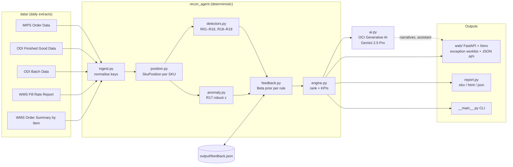

# Inventory Reconciliation Agent: Technical Overview

What the application does, how it is built, and the stack it runs on. For the planner and business view, see [USER_GUIDE.md](USER_GUIDE.md).

## 1. What the application does

The agent reconciles three systems at Bimbo Bakeries USA's Lehigh Valley bakery:

| System | Role | What the agent reads from it |
|---|---|---|
| **MIPS** | In-house production planning | Schedule lines per SKU: BUSS sales orders and OCloud supply-plan lines, moved lines, units per container, retail price |
| **ODI / Oracle Fusion** | Production results | Finished-good runs (net units ordered, wrapped, expected ending inventory) and batch data |
| **WMS** | Warehouse | Customer orders, allocations, fill rate, shipped/loaded quantities |

For every SKU and sales date it builds one **reconciled position**:

```
Net requirement = Total valid demand − Usable inventory − Completed production + Valid returns/adjustments
```

It then runs deterministic rules to find mismatches: R01–R17 on the daily extracts, plus R18 and R19 on the event feed, which carries the WMS ticket, transaction and Oracle posting detail they need. It ranks them by dollar exposure, explains each one as an operational correction, and learns from planner accept/reject decisions.

The core design rule is **rules compute, AI explains**. Every quantity comes from deterministic Python code and carries its evidence. The LLM (Gemini 2.5 Pro on OCI Generative AI) only writes explanation text, root cause, owner and the shift briefing. If the model is unavailable, the pipeline falls back to rule-generated text and loses no functionality.

**Phase 1 (current):** read-only. Inputs are five daily Excel extracts, or (POC, `RECON_SOURCE=events`) a simulated real-time event feed with synthetic data. See [EVENT_CONTRACT.md](EVENT_CONTRACT.md). Outputs are a web worklist, an Excel workbook, an HTML dashboard and a JSON file.
**Phase 2 (planned):** real-time feeds and approved write-back to source systems. See section 10. The POC already runs both against simulated systems: see [EVENT_CONTRACT.md](EVENT_CONTRACT.md) sections 9–10.

## 2. Architecture



### Pipeline (`engine.run`)

1. **Ingest** ([ingest.py](../recon_agent/ingest.py)) reads each extract with openpyxl into typed dataclasses (`MipsLine`, `FgRun`, `BatchRun`, `WmsItem`, `WmsFillOrder`). It normalises join keys: it strips padding and leading zeros from FG numbers and parses the block-layout WMS Order Summary report. Downstream code never sees source quirks. The record mappers (`mips_lines`, `fg_runs`, `batch_runs`, `wms_items`, `fill_orders`) take rows keyed by the extract column names, so the event feed reuses them. [sources.py](../recon_agent/sources.py) picks the feed: `ExcelFeed` (the extracts) or `EventFeed`, which projects the event log in [events/](../recon_agent/events/) into the same `SourceData`. Nothing downstream changes.
2. **Reconcile** ([position.py](../recon_agent/position.py)) groups everything by SKU into a `SkuPosition`. Demand is consolidated across *all* MIPS lines before inventory is applied. This fixes the root cause of scenario 1 (inventory applied to the first line only). Inventory applied is inferred as the demand the first active run was ordered against, less that run's order. On the event feed the projector keeps each MIPS line's quantity history and the source position at which each run's order was last set (`Projector.demand_at_order`, with the seed as the opening snapshot), so a demand change after the order moves the net requirement one for one and never reads as inventory. The extracts have no history, so there the demand is today's. Returns are the larger of the return transactions and the ticket's returned quantity, per ticket. `propose_allocation` applies inventory and then production across lines by priority: earliest sales date first, sales orders before supply plan. Any leftover becomes a carry-forward.
3. **Detect**: [detectors.py](../recon_agent/detectors.py) holds the SKU-level rules (R01, R02, R05–R11, R16) and the run/plant-level rules (R03/R04 ghost and blind runs, R12/R13 WMS report checks, R14 batches, R15 key hygiene). [anomaly.py](../recon_agent/anomaly.py) adds R17: a modified z-score on median/MAD (Iglewicz & Hoaglin), with the scale floored at the mean absolute deviation, applied to wrap overrun % and final piece variance.
4. **Learn** ([feedback.py](../recon_agent/feedback.py)): each rule has a Beta(1,1) prior over planner acceptance. Confidence is the posterior mean normalised so an unseen rule scores 1.0. A rejected finding whose units are unchanged is suppressed on the next run.
5. **Rank**: `priority = (|units| × unit_price + base_priority) × severity_weight × confidence`, with weights High 3, Medium 2 and Low 1.
6. **Explain** ([ai.py](../recon_agent/ai.py)): see section 5.

Each `Finding` carries `rule`, `key`, `sku`, `units`, `unit_price`, `evidence` (a dict of source values), `recommendation` (rule text), `severity`, `confidence`, `systems` and `status`. Its ID is `{rule}-{key}`, which is stable across runs, so decisions survive reloads.

## 3. Tech stack

| Layer | Technology | Version (as installed) | Why |
|---|---|---|---|
| Language | Python | 3.12 | One codebase for engine, AI and UI |
| Excel I/O | openpyxl | 3.1.5 | Reads the five extracts and writes the planner workbook |
| Web framework | FastAPI (on Starlette) | 0.161 | HTML routes and the JSON Reconciliation API; OpenAPI docs at `/api/docs` |
| ASGI server | Uvicorn | 0.54 | Serves the app |
| Templating | Jinja2 | 3.1.6 | Server-rendered pages and fragments |
| Front-end interactivity | htmx (vendored, `static/htmx.min.js`) | 2.0.4 | Partial page swaps and change polling with no JS build step |
| Client script | Vanilla JS (`static/app.js`, ~100 lines) | — | Row selection, keyboard shortcuts (`/`, `j`, `k`, `Esc`), assistant panel |
| Styling | Hand-written CSS (`static/app.css`), self-hosted Doto font | — | Design system in [DESIGN.md](../DESIGN.md) |
| Form parsing | python-multipart | 0.0.32 | FastAPI `Form(...)` fields |
| Config | python-dotenv | 1.2.4 | Loads `.env` |
| AI | OCI Python SDK (`oci`) → OCI Generative AI, model `google.gemini-2.5-pro`, on-demand in `us-chicago-1` | oci 2.189 | The only AI provider used; API-key auth |
| Container | Docker, `python:3.12-slim`, non-root user `recon` (uid 10001) | — | `start_container.bat` builds and runs it on host port 8001 |

`requirements.txt` pins every runtime package; `requirements-dev.txt` adds the test client. Change a pin deliberately and note it in `CHANGELOG.md`.

There is no database in Phase 1. State is held in process memory plus one JSON file (`output/feedback.json`).

## 4. Web application

[web/app.py](../recon_agent/web/app.py) holds the FastAPI app factory. [web/store.py](../recon_agent/web/store.py) holds the live worklist state.

### Store

- Holds the current `RunResult` and groups findings into **rows**: one per SKU, plus one per plant-level finding.
- Tracks claims, acknowledgments and the first-seen time of each finding. These live **in memory only** and are lost on restart. Decisions persist in `feedback.json`.
- Every mutation bumps a monotonically increasing `version` and appends a `Change(version, key, by)`. Open pages hold a server-sent-event connection (`/stream`). On each `changed` event they fetch `/changes?since=N` and get "N rows changed by others", so two screens never silently show different numbers (scenario 6). The `/changes` poll every `WEB_POLL_SECONDS` (20 s) stays as a fallback.
- A watcher thread, started with the app, calls `refresh_if_sources_changed()` every `WEB_WATCH_SECONDS` (0.5 s on the event feed, 2 s on the extracts), so the worklist reconciles even when no page is open.
- `refresh_if_sources_changed()` compares the feed's position on each request (extract mtimes, or the event log's `log_id` and last `seq`) and re-runs the engine when it moves.
- Times in the store (loaded at, claims, acknowledgments, the High SLA) come from the feed's clock: wall time for the extracts, the simulated plant clock for the event feed. In event mode the strip shows a "Simulation" badge and the event number.
- On load, the engine first runs with rule text so the page opens immediately. If OCI credentials exist, cached model text is applied at once to every flag whose ID, units and evidence are unchanged. If any of the top 40 flags are still unexplained, one model call is scheduled after `AI_DEBOUNCE_SECONDS` of quiet (0 on the extracts, 20 s on the event feed), capped at `AI_MAX_WAIT_SECONDS` (120 s) after the first change. The shift briefing is reused only for an identical run. The UI shows "AI explanations ready · Reload".
- A `threading.RLock` guards mutations. The app is designed for a **single process**: running multiple Uvicorn workers would split state.

### Routes

| Method | Path | Purpose |
|---|---|---|
| GET/POST | `/signin`, POST `/signout` | Username and password sign-in; signed session cookie |
| GET | `/healthz` | Liveness (no session): status, version, source mode |
| GET | `/` | Worklist page |
| GET | `/row/{key}` | Row detail (full page, or fragment for htmx) |
| GET | `/queue` | Filtered queue fragment (`day`, `view`, `q`) |
| GET | `/changes?since=N` | Change indicator fragment, plus the freshness line out of band |
| GET | `/stream?since=N` | Server-sent events: `changed` whenever the store's version passes N |
| POST | `/row/{key}/claim`, `/row/{key}/release` | Claim / release a row |
| POST | `/flags/{id}/ack` | Acknowledge a High flag (15-minute SLA) |
| POST | `/flags/{id}/decision` | Accept / reject with note |
| GET | `/briefing` | Expanded shift briefing fragment |
| POST | `/ask` | Assistant answer fragment |

**Reconciliation API (JSON)**, which matches the endpoints named in the architecture deck:

| Method | Path | Returns |
|---|---|---|
| GET | `/api/positions/{sku}` | Reconciled position, ledger and flag IDs |
| GET | `/api/flags?status=open\|all\|decided` | Flags with evidence, recommendation, explanation, priority |
| POST | `/api/flags/{id}/decision` | Body `{"decision": "accept"\|"reject", "note": "..."}` |
| GET | `/api/briefing/{shift}` | Briefing, top actions, narration source |
| POST | `/api/ask` | Body `{"question": "..."}` |
| GET | `/api/feed` | Feed mode, last event reconciled, reconcile time, narration state, duplicates and stale images ignored |
| POST | `/api/corrections` | Body `{"flag_id": "..."}`: approve and send the proposed correction (planner or manager) |
| GET | `/api/corrections`, `/api/corrections/{id}` | Corrections with status history |

OpenAPI docs are served at `/api/docs` when `RECON_API_DOCS=on`.

### Identity

People sign in with a username and password. Accounts live in `output/users.json` ([users.py](../recon_agent/users.py)): PBKDF2-SHA256 hashes (600,000 iterations), a display name, a role (`planner`, `supervisor`, `manager`) and a session counter. Manage them with `python -m recon_agent users list | seed | add | passwd | role | remove`. On first start, with no accounts file, the worklist creates the demo accounts and prints their passwords once (`RECON_DEMO_PASSWORD` sets one password for all of them).

The session cookie (`recon_session`; the simulator's is `sim_session`) carries only the username and the session counter, signed with HMAC-SHA256 over `RECON_SECRET_KEY` and expiring after `RECON_SESSION_HOURS` ([security.py](../recon_agent/security.py)). `user_of()` reads the name and role from the account on every request, so a role change applies at once, and a password change (which bumps the counter) or a removed account ends the session. Request headers such as `X-Remote-User` are not trusted. Failed sign-ins are throttled: 5 per username and 50 per network address per 15 minutes.

Only write-back approval is restricted by role (planners and managers). Every signed-in person can claim, acknowledge, accept and reject.

Every response carries security headers (a Content-Security-Policy without `unsafe-eval`, frame denial, `nosniff`, referrer policy, HSTS over HTTPS, `no-store` on pages), and POST/PUT/PATCH/DELETE requests that a browser marks as cross-site are refused. Planner decisions and corrections are written atomically (temporary file, then rename).

## 5. AI layer

[ai.py](../recon_agent/ai.py) talks to OCI Generative AI through `GenerativeAiInferenceClient` with the generic chat API format.

- **`narrate_with_model()`**: one call per run with a strict JSON-schema response format. It returns `shift_briefing`, `top_actions` and per-finding `explanation`, `root_cause` and `owner`. Owner is one of an enum of five roles. Entries with an unknown owner are dropped.
- **`ask()`**: a tool-using loop of up to 6 turns. The first turn forces a tool call (`ToolChoiceRequired`), because Gemini on OCI rarely calls tools unprompted. The tools read only the current run's data:
  - `search_items`: SKUs whose description in any system, or whose number, contains the text
  - `get_sku_position`: full position with MIPS lines, ODI runs, WMS orders and finding IDs
  - `list_findings`: filter by rule, severity or SKU
  - `plant_summary`: count, units and dollars per rule
- **Fallback**: `offline_narration()` builds the briefing and top actions from KPIs and rule text, and maps each rule to a default owner. With no credentials, the web assistant falls back to keyword/SKU matching over the rows.
- **Auth**: the `OCI_USER_OCID`, `OCI_TENANCY_OCID`, `OCI_FINGERPRINT` and `OCI_PRIVATE_KEY` (or `_PATH`) variables are read from `.env`. If they are absent, the client uses the `~/.oci/config` profile. `OCI_COMPARTMENT_ID` is required for AI to be considered available.
- **Limits**: `OCI_MAX_TOKENS = 32000` (Gemini 2.5 Pro spends part of it on reasoning), with a 300 s read timeout and the SDK default retry strategy.

The system prompt instructs the model to use only supplied or retrieved numbers and never estimate.

## 6. Outputs

`python -m recon_agent run` writes three files to `output/` ([report.py](../recon_agent/report.py)):

- `recon_<date>.xlsx`: the planner workbook. Its sheets are Briefing, Exceptions (with Decision/Note columns for offline review), SKU Positions, Allocation Proposal, Rule Catalog and Data Lineage.
- `recon_<date>.html`: a static dashboard.
- `recon_<date>.json`: KPIs, briefing, top actions and findings, for downstream systems.

## 7. Configuration

Thresholds and UI settings live in [config.py](../recon_agent/config.py). Environment variables (see [.env.example](../.env.example)):

| Variable | Default | Purpose |
|---|---|---|
| `RECON_SOURCE` | `excel` | `excel` reads the extracts; `events` reads the simulated event log |
| `RECON_DATA_DIR` | `data/` | Folder holding the five extracts |
| `RECON_EVENT_DB` | `output/sim/events.db` | Event log (SQLite) for `RECON_SOURCE=events` |
| `RECON_AI` | `on` | `off` disables every model call, even with credentials (tests, offline demos) |
| `RECON_SECRET_KEY` | random per process | Signs session cookies; set it on a server, or every restart signs everyone out |
| `RECON_USERS_FILE` | `output/users.json` | Accounts (username, name, role, password hash) |
| `RECON_DEMO_PASSWORD` | empty | One password for the demo accounts created on first start; empty means random ones, printed once |
| `RECON_SESSION_HOURS` | `12` | How long a sign-in lasts |
| `RECON_COOKIE_SECURE` | `on` | Session cookies over HTTPS only (browsers also accept them on `http://localhost`) |
| `RECON_ALLOWED_ORIGINS` | the request's host | Origins allowed to POST, for a proxy that rewrites `Host` |
| `RECON_FORWARDED_ALLOW_IPS` | `127.0.0.1` | Proxies trusted for `X-Forwarded-For` / `-Proto` |
| `RECON_API_DOCS` | `off` | `on` serves Swagger UI at `/api/docs` |
| `RECON_WORKLIST_URL` | `http://localhost:8000/` | Target of the simulator's "Open worklist" button |
| `RECON_CORRECTIONS_URL` | `http://127.0.0.1:8100/oic/corrections` | Where the worklist sends approved corrections (the simulator stands in for Oracle Integration) |
| `RECON_CORRECTIONS_TOKEN` | empty | Shared token for that endpoint, if set on both sides; set it whenever the simulator is reachable from another machine |
| `RECON_FEEDBACK_FILE` | `output/feedback.json` (`output/sim/feedback.json` in event mode) | Planner decisions and rule stats |
| `OCI_REGION` | `us-chicago-1` | GenAI region |
| `OCI_COMPARTMENT_ID` | — | Required to enable AI |
| `OCI_SERVICE_ENDPOINT` | derived from region | Override the inference endpoint |
| `OCI_MODEL_ID` | `google.gemini-2.5-pro` | Model |
| `OCI_USER_OCID`, `OCI_TENANCY_OCID`, `OCI_FINGERPRINT`, `OCI_PRIVATE_KEY` / `OCI_PRIVATE_KEY_PATH`, `OCI_PRIVATE_KEY_PASSPHRASE` | — | API-key auth |
| `OCI_CONFIG_PROFILE` | `DEFAULT` | Fallback `~/.oci/config` profile |

Key tunables in `config.py`:

| Setting | Value | Meaning |
|---|---|---|
| `QTY_TOLERANCE_UNITS` | 0 | Exact match required between systems |
| `CARRYOVER_MIN_UNITS` | 50 | Minimum surplus for R06 |
| `OVERPRODUCTION_MIN_UNITS` | 100 | Minimum recovery-run over-build for R05 |
| `ROBUST_Z_THRESHOLD` | 3.5 | Outlier cut-off for R17 |
| `DEFAULT_UNIT_PRICE` | 3.99 | Price used when MIPS has none |
| `HIGH_ACK_MINUTES` | 15 | Acknowledgment SLA for High flags |
| `WEB_POLL_SECONDS` | 20 | Change-poll interval |

`DAY_CODES` and `SALES_WEEKDAYS` (sales-day tag colours and calendar) are **provisional** until the plant confirms them.

Source file discovery uses glob patterns in `config.SOURCES`. If several files match one pattern, the last one in name order wins.

## 8. Running it

**Local (Python 3.12):**

```bash
pip install -r requirements.txt
cp .env.example .env            # optional: add OCI credentials for AI text

python -m recon_agent run [--offline] [--out-dir output]   # batch run → output/
python -m recon_agent serve [--host 127.0.0.1] [--port 8000] # worklist at http://127.0.0.1:8000/
python -m recon_agent ask "Why is MIPS asking for more 150080?"
python -m recon_agent feedback R05-8526 accept --note "Applied to Monday"
python -m recon_agent feedback --from-workbook output/recon_2026-09-12.xlsx

# Simulated event feed (synthetic data; see EVENT_CONTRACT.md)
python -m recon_agent events seed --reset                      # publish the synthetic starting day
RECON_SOURCE=events python -m recon_agent serve                # worklist on the event feed
python -m recon_agent events set wms.item_order WL-0015 "Order Qty=800"   # change data live
python -m recon_agent events clock --rate 60                   # 1 real second = 1 plant minute
python -m recon_agent simulate                                 # source simulator at http://127.0.0.1:8100/

python -m unittest discover -s tests -v                        # test suite
```

**Docker (Windows):** `start_container.bat` builds the `recon-agent:latest` image if it is missing. It then runs the container with the project folder bind-mounted at `/app` (so `data/` and `output/` live on the host), passes `.env` through, and exposes it on **http://localhost:8001/**. The subcommands are `build`, `shell`, `run`, `stop`, `remove`, `logs` and `status`. The image excludes `data/`, `docs/`, `.env` and all Office files. The container health check hits `/healthz`. `start_container.bat users ...` manages accounts inside the container.

**Server deployment:** `docker-compose.yml` with the published image, optional TLS and the simulator profile. See [DEPLOYMENT.md](DEPLOYMENT.md).

## 9. Project layout

```
.
├── recon_agent/               Application package
│   ├── __init__.py            Package version (__version__)
│   ├── __main__.py            CLI: run | ask | feedback | serve | simulate | events | users
│   ├── security.py            Signed sessions, password hashing, security headers, atomic JSON writes
│   ├── users.py               Sign-in accounts and the `users` command
│   ├── config.py              Paths, source patterns, thresholds, OCI settings
│   ├── ingest.py              Excel adapters → canonical records
│   ├── position.py            Reconciled SKU position + allocation proposal
│   ├── detectors.py           Rules R01–R16 and R18–R19, Finding model, rule catalogue
│   ├── corrections.py         Write-back: proposals, the corrections book, send and confirm
│   ├── anomaly.py             R17 robust-z outliers
│   ├── feedback.py            Planner decisions → rule confidence
│   ├── engine.py              Pipeline orchestration + KPIs
│   ├── ai.py                  OCI Generative AI narration + tool-using assistant
│   ├── report.py              xlsx / html / json writers
│   ├── sources.py             Feed selection: Excel extracts or the event log (RECON_SOURCE)
│   ├── events/                Event contract, append-only log, simulated clock, projector, derived columns, seed, CLI
│   ├── simulator/             Source simulator (System B): FastAPI + htmx operator app that publishes events
│   └── web/                   FastAPI app, in-memory store, Jinja templates, static assets
├── tests/                     unittest suite: feed, seed, the 8 scenarios, faults, write-back, simulator, push, AI debounce
├── data/                      Daily source extracts (5 × .xlsx) — client data, not in the image
├── output/                    Generated reports and feedback.json
├── docs/
│   ├── USER_GUIDE.md          User and business guide (ASD-STE100)
│   ├── TECHNICAL_OVERVIEW.md  This document
│   ├── EVENT_CONTRACT.md      Event contract v1, simulated clock, synthetic dataset
│   ├── DEPLOYMENT.md          Server deployment, HTTPS, accounts, releases
│   └── reference/             Requirement brief and pitch decks from the client engagement
├── PRODUCT.md, DESIGN.md      Product context and design system (read by the Impeccable design tooling; keep at root)
├── Dockerfile, .dockerignore, docker-compose.yml, deploy/Caddyfile, start_container.bat
├── .github/workflows/         CI (tests, image build) and release (image to GHCR on a vX.Y.Z tag)
├── pyproject.toml, CHANGELOG.md
├── requirements.txt, requirements-dev.txt
└── .env.example
```

## 10. Target production architecture (planned, not built)

This is from the architecture deck. None of it exists in this repo yet.

- **Ingestion:** OCI GoldenGate (MIPS database CDC), Oracle Integration 3 (WMS, BUSS, Oracle Fusion business events) and OCI Streaming replace the Excel extracts. Target: source event to alert under 2 minutes at p95.
- **Runtime:** containers on OCI Kubernetes Engine (OKE) behind OCI API Gateway.
- **Identity & secrets:** OCI IAM Identity Domains (least privilege per role) and OCI Vault. TLS 1.2+. The plant is reached over FastConnect or VPN. No source system is exposed publicly.
- **Alerts:** High alerts go to SMS + Teams + worklist (15 min ack). Medium alerts go to Teams + worklist (2 h). Low alerts go to the worklist + shift briefing. There is one alert per flag, updated in place.
- **New rules:** R18 (WMS transaction not in Oracle within 10 min) and R19 (return-to-plant not reducing received qty) run on the event feed today; in production they need the real WMS ticket feed and Oracle posting status.
- **Write-back (Phase 2):** the flow is Flagged → Proposed → Approved → Sent (Corrections API → OIC) → Confirmed, with `POST /corrections` and `GET /corrections/{id}`. Auto write-back is allowed only for rules at ≥98% acceptance over 8 weeks. Every correction has a unique ID and before/after values for reversal. Records are retained for 2 years.

## 11. Known gaps

- Tests cover the event feed, the eight scripted scenarios (which double as the rules' regression suite), integration faults and write-back (`tests/`), not the rules on real data. The validation run for 2026-09-12 (103 findings, $227,014 exposure with the current `feedback.json`) is still the regression baseline for the extracts.
- The event feed is simulated. Its shape is an assumption until Bimbo IT confirms it ([EVENT_CONTRACT.md §6](EVENT_CONTRACT.md#6-assumptions-to-confirm-with-bimbo-it)). Sign-in uses local accounts (username and password), not OCI IAM.
- Claims, acknowledgments and the change log are in memory, so a restart clears them. Only one process can run.
- Only write-back approval is restricted by role.
- The returns/adjustments term of the net-requirement equation is 0 for the daily extracts; on the event feed it is the WMS return-to-plant quantity.
- Open questions with the client cover the WMS product and APIs, MIPS database and GoldenGate access, the BUSS order feed, Oracle Fusion events, ticket/return/freezer-lot detail in WMS, the plant network and alert recipients per shift.
