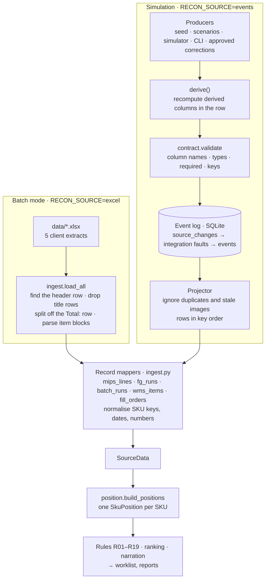

# Client Extracts vs Simulation Data: Mapping and Data Flow

> **Data model changed (v3, 9 Nov 2026).** The agent now uses the business team's mapping: BUSS orders, Oracle forecast, ODI batch mapping, WMS stock and MIPS work orders, with 13 rules. See [DATA_MODEL_9NOV.md](../DATA_MODEL_9NOV.md) and [EVENT_CONTRACT.md](../EVENT_CONTRACT.md). Where this guide describes MIPS order lines, ODI runs, tickets, rules R01-R19 or carry-forward, it describes v2 and is due for a rewrite.

How the simulation's dummy data maps to the five client extracts in `data/`, how closely it matches them, and how data flows from either source to the worklist.

**Compared:** the five extracts for Saturday 12 Sep 2026 (`MIPS Order Data`, `ODI Finished Good Data`, `ODI Batch Data`, `WMS - Fill Rate Report`, `WMS - Order Summary Report by Item`) against the seeded starting day (`recon_agent/events/seed.py`). Every column was profiled on 03 Nov 2026: names, order, types, empty values, value formats and the formulas between columns.

> The client files are not in Git (`.gitignore`: "Client data … never committed"), so this document gives **formats, patterns and counts only**: no client item numbers, names, quantities or prices. All worked examples use dummy data.

Related: [DUMMY_DATA_EXPLAINED.md](DUMMY_DATA_EXPLAINED.md) (what the dummy data contains), [EVENT_CONTRACT.md](../EVENT_CONTRACT.md) (the event format).

---

## 1. Verdict

The dummy data **matches the client extracts in structure, and in most conventions that the engine depends on**. Its values are synthetic by design. Some secondary conventions and four derived-column formulas do not follow the client files.

| Aspect | Match | Detail |
|---|---|---|
| Column names and order | **Yes, exactly** | All 5 extracts. The simulation only adds a synthetic row key per table, plus `Sales Date` on WMS item lines (the report prints it once in its header). |
| Column types | **Mostly** | Dates arrive from Excel as date-times at midnight; the simulation uses dates. The engine treats both the same. WMS `Item Nbr`, `Order Nbr` and `Route Nbr` are **numbers** in the client files and **text** in the simulation. |
| Join keys and key quirks | **Yes, with one gap** | BUSS lines pad the FG Oracle Ref; the BUSS code equals the ODI legacy number; ODI formula codes equal batch codes; customer names are shared between the two WMS reports. **Gap:** client item numbers are 4–6 digits and padding varies; dummy ones are always 6 digits. See section 5. |
| Conventions the rules depend on | **Yes** | Moved-line dates, `Source System` values, ghost runs (zero quantity, no shift), the "A" suffix on moved runs, negative net orders, units-per-container conflicts. |
| Derived columns | **5 of 10 formulas match** | Matching: `ExpectedEndingInventoryQty`, `TotalActualDamagedUnits`, `Short Qty`, `% Allocated`, `% Shipped`. Different: stacks/trays, `Order Units Qty`, `TotalPieces`, `Final Piece Variance %`. Unproven: `Progress`/`Completion%` (section 4). |
| Secondary conventions | **Partly** | About 10 differ, none of which a rule reads: production and ship dates on BUSS lines, zero retail prices, `M1` containers, descriptions that differ by system, order-number formats. All are listed in section 7. |
| Volume and values | **No, by design** | Client: 78–79 items, 157 MIPS lines, 86 ODI runs, 18 orders, 16 customers. Dummy: 12 items, 17 lines, 14 runs, 4 orders, 4 customers. Every name starts with `SIM`. |
| Situations the rules see | **14 of 16 rule types** | Client data raises 104 findings across R01–R15 and R17. The dummy starting day raises 14 findings across R01–R12, R14 and R15. R13 and R17 occur in the client data but are not seeded. R18 and R19 have no client data to compare with. |
| Tickets, WMS transactions, Oracle postings | **No client file** | These three tables have an assumed shape (EVENT_CONTRACT.md §6), so there is nothing to compare them with. |

---

## 2. Data flow

The two paths, the daily Excel extracts and the simulated event feed, meet at the **record mappers** in [ingest.py](../../recon_agent/ingest.py). The mappers take rows keyed by the **client's own column names**. That is why the dummy data has to use exactly the client's columns: the same code then reads both.



### Batch mode (client extracts)

1. **Find the files.** [config.SOURCES](../../recon_agent/config.py) holds one name pattern per extract. If several files match, the last by name wins.
2. **Read the active sheet** as values (`_rows`).
3. **Find the header row** by its first cell: `Plant Code` (MIPS), `PlantName` (both ODI files) or `Facility` (Fill Rate). This skips the two title rows ("Printed On: …" and the sheet name) at the top of the MIPS and ODI files (`_table`).
4. **Fill Rate:** the `Total:` row (in the `Order Type` column) is taken out and kept as `fill_report_total` (`load_fill_rate`).
5. **Order Summary by Item:** a block parser flattens the report (`load_wms_order_summary`). It also keeps each item's printed subtotal for R13.
6. **Record mappers** turn each row into a typed record. `norm_sku` removes spaces, a trailing `.0` and leading zeros from every item number, so `"NNNNN  "`, `NNNNN` and `NNNNN.0` all become `NNNNN`.

### Simulation (dummy data)

1. **A producer** makes a change: an insert, update or delete of one row, using the client's column names. Producers are the seed, a scenario step, the simulator's editor, `events set`, or an approved correction.
2. **`derive()`** recomputes the columns the source system would calculate itself ([derive.py](../../recon_agent/events/derive.py)).
3. **`contract.validate`** checks it against the column list, which mirrors the extract headers ([contract.py](../../recon_agent/events/contract.py)).
4. **The event log** stores the change in `source_changes` (the systems' truth). Delivery to `events` can be delayed, dropped, duplicated or reordered when a fault is active.
5. **The projector** applies delivered events to one table per entity. It skips duplicates and stale images, and returns rows **sorted by row key** ([projector.py](../../recon_agent/events/projector.py)). Key order stands in for the extract's line order, which matters for R01 ("inventory applied to the first line").
6. **`projector.source_data()`** passes those rows to the **same record mappers**. A live feed has no printed report total, so `fill_report_total` is the sum of the `wms.order` headers.

From `SourceData` onwards, both paths are identical.

---

## 3. File-to-table mapping

| Client extract (`data/`) | Sheet | Layout | Header row | Simulation table | Row key | Client rows | Dummy rows |
|---|---|---|---|---|---|---|---|
| `MIPS Order Data*.xlsx` | All Orders | Flat table under 2 title rows | Row 3, first cell `Plant Code` | `mips.order_line` | `Order Line ID` *(synthetic)* | 157 | 17 |
| `ODI Finished Good Data*.xlsx` | FinishedGoodDataEntry | Flat table under 2 title rows | Row 3, `PlantName` | `odi.finished_good` | `FGEntryID` *(synthetic)* | 86 | 14 |
| `ODI Batch Data*.xlsx` | Batch Data Entry | Flat table under 2 title rows | Row 3, `PlantName` | `odi.batch` | `BatchEntryID` *(synthetic)* | 36 | 6 |
| `WMS - Fill Rate Report*.xlsx` | Fill Rate Report_Universal | Flat table plus a `Total:` footer row | Row 1, `Facility` | `wms.order` | `Order Nbr` *(native)* | 18 + total | 4 |
| `WMS - Order Summary Report by Item*.xlsx` | Order Summary Report by Item_Un | Report: page header, then one block per item with a subtotal row | none (blocks) | `wms.item_order` | `Item Line ID` *(synthetic)* | 364 lines, 77 items | 23 lines, 11 items |
| *(no extract)* | | | | `wms.ticket`, `wms.transaction`, `oracle.inventory_txn` | `Ticket Nbr`, `Txn Nbr`, `TransactionId` | none | 11 each |

A *synthetic* key does not exist in the client file. The contract adds it so a change event can name the row it updates (EVENT_CONTRACT.md assumptions A1–A4).

---

## 4. Column mapping, extract by extract

**Engine field** is the attribute in [ingest.py](../../recon_agent/ingest.py); "—" means the engine carries the column but never reads it. **Match** compares the client format with the dummy format:

- ✅ same
- ◐ same convention, narrower range
- ❌ different

### 4.1 MIPS Order Data → `mips.order_line` → `MipsLine`

| Client column | Engine field | Client format | Dummy format | Match |
|---|---|---|---|---|
| `Plant Code`, `Plant Name` | — | `UBD`, `LEHIGH VALLEY PA BAKERY` | same | ✅ |
| `Schedule Date` | `schedule_date` | the sales day on every line (date-time at 00:00) | the sales day (date) | ✅ |
| `Offset Sales Date`, `BUSS Sales Date`, `Product Sales Date` | `offset_sales_date` | sales day, or sales day − 1 on moved lines; BUSS Sales Date = Offset Sales Date | same | ✅ |
| `Order Moved` | `order_moved` | TRUE on 26% of lines, on both BUSS and OCloud lines | TRUE on 1 BUSS line | ◐ |
| `Requested Ship Date` | — | **empty on BUSS lines**; OCloud: offset sales day − 1 | BUSS: sales day; OCloud: − 1 | ❌ BUSS |
| `Production Date` | `production_date` (unused) | **always filled.** BUSS: sales day (moved: − 1). OCloud: − 1 (moved: − 2) | **empty on BUSS**; OCloud: − 1 | ❌ BUSS |
| `FG Oracle Ref` | `sku` (normalised), `raw_sku` | text, **4–6 digits**; BUSS lines left-aligned and space-padded to **7 characters**; OCloud lines unpadded | text, always 6 digits; BUSS lines get 1 trailing space (also 7 characters) | ◐ |
| `FG BUSS Code` | `buss_code` | 6-digit text with leading zeros; equals ODI `LegacyFGNumber` | `0091xx`; same rule | ✅ |
| `FG Description` | `description` | MIPS naming; differs from the ODI name for 70% of items | one `SIM …` name used by every system | ❌ (not a key) |
| `Order Quantity` | `order_qty` | whole units, never 0 | whole units; one 0 line (the designed blind line) | ◐ |
| `Container Code` | `container_code` | `01`, and `M1` on 17% of lines (BUSS only) | `01` only | ◐ |
| `Units per Container` | `units_per_container` | 3–12 | 6, 10, 12 | ◐ |
| `Units Per Carton` | — | 0 on BUSS, **empty on OCloud** | 0 everywhere | ❌ |
| `Containers per Rack` | — | 15, 17 or 21: the trays per stack WMS prints (4.5) | 17 or 21 | ✅ |
| `Retail Price` | `retail_price` | decimal; **0 on 38% of lines** (both sources) | always set | ❌ |
| `Closed` | — | `F` | `F` | ✅ |
| `Source System` | `source_system` | `BUSS` or `OCloud Region2` | same | ✅ |
| `Last Modify Date Time` | `last_modified` | one batch stamp per source: BUSS 20:31 on the sales day (moved lines 20:32 the day before); OCloud 15:32 four days before (moved lines 16:02 five days before) | BUSS 20:31 two days before; OCloud 15:32 four days before | ◐ |
| `Scheduling Errors` | — | empty | empty | ✅ |

### 4.2 ODI Finished Good Data → `odi.finished_good` → `FgRun`

| Client column | Engine field | Client format | Dummy format | Match |
|---|---|---|---|---|
| `PlantName`, `SalesDate` | `sales_date` | one plant, one sales day | same | ✅ |
| `ProductionStartDateTime`, `ProductionEndDateTime` | `start`, `end` | 2–4 days before the sales day, to the second | 2–3 days before, on the hour or half hour | ◐ |
| `LineCode` | `line` | `Line 1`–`Line 3` | `Line 1`–`Line 2` | ◐ |
| `ShiftName` | `shift` | `Shift 1`–`3`; empty only on zero runs | same | ✅ |
| `OracleTypeCode` | `formula_type` | `SU` + 6 digits; `A` suffix on 10 of 86 rows (moved or alternate runs); one code shared by up to 13 items | `SU9001xx`; `A` on 1 row; shared by at most 2 items | ◐ |
| `LegacyFGNumber` | `buss_code` | 6-digit text; equals MIPS `FG BUSS Code` on every matched item; equals the Oracle number on 20% of rows | always `0091xx`, never equal to the Oracle number | ◐ |
| `OracleFGNumber` | `sku` | text, 4–6 digits | text, 6 digits | ◐ |
| `OCloudFGItemStructure` | `item_structure` | `Primary`, or `Secondary` on 17 rows | `Primary` only | ◐ |
| `OracleFGDescription` | `description` | ODI naming | `SIM …` | ❌ (not a key) |
| `NetUnitsOrdered`, `ActualWrappedUnits` | `net_units_ordered`, `wrapped_units` | whole units; includes zero runs (5) and negative net orders (2) | same patterns (2 zero runs, 1 negative) | ✅ |
| `ExpectedEndingInventoryQty` | `expected_ending_inventory` | = wrapped − ordered on every row | same formula (derived) | ✅ |
| `MIPSBeginningInventoryQty` | `mips_beginning_inventory` | **0 on every row**, including the negative-net rows | 0, except 1,500 on 900110 (the R08 design) | ◐ |
| `MIPSInventoryAdjustmentQty`, `MIPSOrderAdjustmentQty` | used / — | 0 | 0 | ✅ |
| `MIPSOrderQty` | `mips_order_qty` | 0 on 27% of rows | 0 on 8 of 14 rows | ✅ |
| Damaged weight and unit columns | `damaged_units` (total) | small decimals on most rows; `TotalActualDamagedUnits` = with wrap + without wrap | 0 everywhere; same formula | ◐ |
| `TheoreticalRunTime` | — | decimal; not the run's elapsed minutes | the run's elapsed minutes | ❌ |
| `TotalPieces` | — | **= (wrapped + damaged) × OraclePiecesPerPkg** | wrapped + damaged | ❌ formula |
| `OraclePiecesPerPkg` | `pieces_per_pkg` | the pack count in the name: `8P` → 8, `16P` → 16, `2P` → 2, otherwise 1 | 2 for the `2P` loaf, but **1 for the `8P` buns** | ❌ |

### 4.3 ODI Batch Data → `odi.batch` → `BatchRun`

| Client column | Engine field | Client format | Dummy format | Match |
|---|---|---|---|---|
| `SalesDate`, `WrappingStartDateTime`, `WrappingEndDateTime` | `sales_date`, `wrap_start` | as ODI runs; zero batches have 00:00 times | as ODI runs; no zero batches | ◐ |
| `Prod Line`, `Shift` | `line`, `shift` | `Line 1`–`3`; 3 zero rows with no shift | `Line 1`–`2`; always a shift | ◐ |
| `Oracle Type` | `formula_type` | equals a finished-good `OracleTypeCode` on every row; `A` suffix on 8 rows | same rule | ✅ |
| `Oracle Formula` | — | `PH` + 6 digits (some with `A`); **not derivable** from `Oracle Type` | `PH` + the digits of `Oracle Type` | ❌ (not read) |
| `MIPS Description` | `description` | batch naming | `SIM …` | ❌ (not a key) |
| `MIPS Sched Batches`, `Act Batches Mixed` | `sched_batches`, `actual_batches` | mixed ≠ scheduled on 1 row | 1 row | ✅ |
| `Theo Batch Pieces Qty` | `theo_pieces` | roughly 1,200–1,500 pieces per batch | 500–820 per batch | ◐ |
| `Final Piece Variance Qty` | `final_piece_variance` | decimals, positive and negative | same | ✅ |
| `Final Piece Variance %` | `final_piece_variance_pct` (unused) | **a percentage: 100 × variance ÷ theoretical pieces** | a fraction: variance ÷ theoretical pieces (100× smaller) | ❌ formula |
| Weight columns | — | some non-zero | all 0 | ◐ |

### 4.4 WMS Fill Rate Report → `wms.order` → `WmsFillOrder`

| Client column | Engine field | Client format | Dummy format | Match |
|---|---|---|---|---|
| `Facility` | — | `UBD`; empty on the `Total:` row | `UBD` | ✅ |
| `Order Nbr` | `order_nbr` | **number**: 7 digits for transfer orders, 14 digits for DSD orders | text, 7 digits for both | ◐ |
| `Ship to Name` | `ship_to` | the same names as the item report; 2 customers have 2 orders | `SIM …`; one order per customer | ◐ |
| `Progress` | — | `GREEN` on every row, **including 5 rows with a shortfall** | derived: `YELLOW` when short | unproven |
| `Route Nbr` | — | number, 8 digits, on 2 of 7 DSD orders | text, 7 digits, on both DSD orders | ◐ |
| `Order Type` | `order_type` | `TRANSFER_ORDER`, `DSD_SALES_ORDER`; `Total:` on the footer row | same, no footer row | ✅ |
| `Sales Date` | `sales_date` | the sales day | same | ✅ |
| `Order Qty`, `Allocated Qty`, `Packed Qty`, `Shipped Qty` | same names | Packed = Allocated = Shipped on every row | the same for shipped orders; 2 orders are not shipped yet | ◐ |
| `Loaded Qty`, `% Loaded` | `loaded_qty` | **0 on every row**, so R12 covers every order | one order loaded, the others 0 | ◐ |
| `Short Qty` | `short_qty` | = order − allocated | same formula (derived) | ✅ |
| `% Allocated` | — | a percentage, 0–100 | same | ✅ |
| `% Shipped` | — | a fraction, 0–1, on order rows; a percentage on the `Total:` row | a fraction; no footer | ✅ |

### 4.5 WMS Order Summary Report by Item → `wms.item_order` → `WmsItem`

The client report is a **printed layout**. The simulation stores the **same columns as flat rows**:

```
Client report (one block per item)                 Simulation (one row per item and customer)
───────────────────────────────────                ───────────────────────────────────────────
Order Summary Report by Item                       Item Line ID  WL-0001
Bimbo Bakeries USA …  <plant name>                 Sales Date    2026-11-07     ← header value, repeated
Sales Date:  <date>                                Item Nbr      900101         ← from the item row
Item Nbr: | Units per Container | Description:     Units per Container 10
<item>    | <upc>               | <description>    Description   SIM 100% WW BREAD 24Z
Cust Name | Original Ord Qty | Order Qty | …       Cust Name     SIM DC NORTH   ← one customer row
<customer>| …                                      Original Ord Qty 5000, Order Qty 5000, …
<customer>| …
(blank)   | <subtotals>          ← kept for R13    (no subtotal row; R13 compares the order headers)
```

| Client column | Engine field | Client format | Dummy format | Match |
|---|---|---|---|---|
| `Item Nbr` | `sku` | **number**, 4–6 digits | text, 6 digits | ◐ |
| `Units per Container` | `units_per_container` | 3–12; differs from MIPS on 3 items | 10 or 12; differs on 900109 | ✅ |
| `Description` | `description` | WMS naming; differs from the MIPS name for 66% of items | `SIM …` (same everywhere) | ❌ (not a key) |
| `Cust Name` | `customer` | the same names as Fill Rate `Ship to Name` | same rule | ✅ |
| `Original Ord Qty`, `Order Qty` | `original_qty`, `order_qty` | differ on 5 lines | differ on 1 line (WL-0015) | ✅ |
| `Allocated Units Qty` | `allocated_units` | differs from Order Qty on 1 line | 1 line | ✅ |
| `Order Stack Qty`, `Order Tray Qty` (and the allocated and remaining versions) | `stacks_remaining`, `trays_remaining` | trays = units ÷ units per container; **stacks = trays ÷ the item's MIPS `Containers per Rack`** (17 for most 10-unit items, 21 for 12-unit items) | derived with a **fixed 21 trays per stack** | ❌ formula |
| `Order Units Qty` | — | the units left over that don't fill a tray (non-zero on 26 lines) | always 0; not derived | ◐ |
| `Completion%` | `status` | `GREEN` on every line, including the one short line | derived: `YELLOW` when short | unproven |
| Item subtotal row | `report_total_order_qty` | one per item | none (event feed) | by design |
| Header vs line totals | — | Fill Rate headers ≠ item lines for 4 customers; plant totals differ (R13 fires) | equal at seed time | ◐ |

---

## 5. How records in one system find their match

| Link | Client data | Dummy data |
|---|---|---|
| **Item number** across MIPS, ODI and WMS | Three forms: padded text (MIPS BUSS), text (ODI), number (WMS), 4–6 digits. **Matches only after `norm_sku`.** 76 items are in all three systems; 2 only in ODI, 1 in MIPS + ODI, 1 in MIPS + WMS. | Text in every system, 6 digits, one padding style. 11 items in all three; 900104 in MIPS + ODI only. |
| MIPS lines per item | 1–4 (35 items have 2, 12 have 4) | 1–3 |
| ODI runs per item | 1–2 | 1–2 |
| Formula code: ODI run ↔ batch | every batch code is a run code | same |
| `FG BUSS Code` ↔ `LegacyFGNumber` | always equal | always equal |
| Customer: item report ↔ Fill Rate | the same name set | the same name set |
| WMS transaction ↔ Oracle posting, ticket ↔ return | no client data | `Txn Nbr` = `SourceReference`; `Ticket Nbr` |

The agent never matches on descriptions. That is just as well: in the client data the same item has a different description in MIPS, ODI and WMS most of the time.

---

## 6. Worked examples (dummy data)

### Example 1: one MIPS line, both paths, same record

A BUSS sales-order line for item 900101, as the client extract would print it and as the simulation stores it:

| Column | In a client-format extract | In the event log (`mips.order_line`, after image) |
|---|---|---|
| `Order Line ID` | *(does not exist)* | `ML-0002` |
| `Schedule Date` | 2026-11-07 00:00:00 | 2026-11-07 |
| `Offset Sales Date` | 2026-11-07 00:00:00 | 2026-11-07 |
| `Order Moved` | FALSE | false |
| `FG Oracle Ref` | `"900101 "` | `"900101 "` |
| `Order Quantity` | 2400 | 2400 |
| `Source System` | BUSS | BUSS |

Both rows go through `ingest.mips_lines()` and produce the same record:

```python
MipsLine(sku="900101", raw_sku="900101 ", order_qty=2400.0, source_system="BUSS",
         schedule_date=date(2026, 11, 7), offset_sales_date=date(2026, 11, 7), order_moved=False, ...)
```

The padded `raw_sku` is kept only so R15 can report it. Everything else uses `sku`.

### Example 2: from rows to a flag (item 900101)

| Source rows | Values |
|---|---|
| MIPS `ML-0001` (moved, BUSS), `ML-0002` (BUSS), `ML-0003` (OCloud) | 1,300 + 2,400 + 7,600 = **11,300** demand; 10,000 for the sales day (the moved line belongs to the day before) |
| ODI `FG-0001` | `NetUnitsOrdered` 9,000, `ActualWrappedUnits` 9,000 |
| WMS `WL-0001`–`WL-0003` | 5,000 + 3,000 + 2,000 = **10,000** ordered and allocated |

What the engine works out ([position.py](../../recon_agent/position.py)):

- Implied inventory = 11,300 − 9,000 sent to production = **2,300**.
- Net requirement = 11,300 − 2,300 − 9,000 = **0**: the item is covered.
- R09 compares WMS 10,000 with the sales-day demand of 10,000: they are equal, so **no R09**. This is why moved lines must keep the prior day's `Offset Sales Date`, exactly as the client data does.
- R01 applies the 2,300 to the first line only (1,300). MIPS then asks for 10,000 instead of 9,000, so **R01 flags 1,000 units**. This depends on line order: in the simulation the projector sorts rows by `Order Line ID`, so `ML-0001` is "first".

### Example 3: where a derived column departs from the client (stacks and trays)

`WL-0001`: 5,000 units of 900101 for SIM DC NORTH, 10 units per container, so 500 trays.

| Rule | Order Stack Qty | Order Tray Qty |
|---|---|---|
| **Client convention:** trays per stack = the item's MIPS `Containers per Rack` (17 for this item) | 500 ÷ 17 = **29** | remainder **7** |
| **Simulation now:** `derive.py`, fixed 21 trays per stack | 500 ÷ 21 = **23** | remainder **17** |

No rule reads these columns, so no flag changes. But a planner comparing the simulator with a real WMS screen would notice the difference. 16 of the 23 dummy item lines are affected.

### Example 4: a live change through the event path (scenario S6)

1. The scenario updates `wms.item_order` `WL-0023`: `Order Qty` 900 → 1,100.
2. `derive()` recomputes that row's `Order Stack Qty`, `Order Tray Qty`, `Stacks Remaining`, `Trays Remaining` and `Completion%` (YELLOW).
3. The contract checks the row; the log stores it in `source_changes` and delivers it to `events`, possibly late if a WMS delay fault is active.
4. The worklist's watcher sees the log move, and the projector replaces row `WL-0023`.
5. `wms_items()` rebuilds item 900112: WMS 1,100 against MIPS `ML-0017` 900. The worklist raises **R09** (+200) and **R10** (200 short).

The MIPS row was never touched. Nothing in the simulation passes a change from one system to another, just as nothing does at the plant.

---

## 7. Gaps and suggested fixes

Ordered by value. **Flags** says whether a fix would change the seed's 14 expected flags, which would mean updating `seed.EXPECTED` and the tests.

| # | Gap | Effect today | Suggested fix | Flags |
|---|---|---|---|---|
| 1 | Trays per stack fixed at 21 | Stack and tray columns disagree with the client convention on 16 of 23 lines | In `derive.py`, use the item's MIPS `Containers per Rack`, carried on the WMS row or looked up by item | No |
| 2 | `Final Piece Variance %` is a fraction | Values are 100× smaller than in the client file | Multiply by 100 in `derive.py` | No |
| 3 | `TotalPieces` ignores pieces per package | Wrong for multi-pack items | `(wrapped + damaged) × OraclePiecesPerPkg` | No |
| 4 | `OraclePiecesPerPkg` = 1 on `8P` buns | Unrealistic; feeds #3 | Set it from the pack count (8) | No |
| 5 | BUSS lines: `Production Date` empty and `Requested Ship Date` filled | Opposite of the client file. The guide PDF (section 10) also states the wrong convention | BUSS: Production Date = sales day (− 1 if moved), Requested Ship Date empty; OCloud: `Units Per Carton` empty | No |
| 6 | Item numbers always 6 digits, numeric WMS fields stored as text | Normalisation is never tested on short numbers, multi-space padding or numeric values | Add one or two 4–5-digit items; let WMS `Item Nbr`/`Order Nbr` arrive as numbers | Only if the new items carry problems |
| 7 | No zero retail prices or `M1` container lines | The $3.99 fallback, and ignoring `M1` lines in R11, are never exercised | Add a zero-price line and an `M1` line on a **new** item (an `M1` line adds demand, so not on an existing one) | No, if on a new item |
| 8 | Same description in every system | Hides the fact that descriptions cannot be matched | Give each system its own naming style, still starting with `SIM` | No |
| 9 | `Progress` / `Completion%` turn YELLOW when short | The client data never shows YELLOW, even on short orders | Confirm the real rule with Bimbo IT; until then, document it as an assumption | No |
| 10 | DSD order and route numbers | 14-digit DSD orders and 8-digit routes in the client; one order per customer in the dummy | Use the client lengths; give one customer two orders | No |
| 11 | Recorded beginning inventory on 900110 | The client never records beginning inventory, even on negative net orders | Leave as is (it makes R08 easy to read), or set it to 0 and re-check R08 | Possibly |
| 12 | R13 and R17 not seeded | Both fire on the client data | Seed a header/line mismatch and one wrap outlier (R17 needs at least 8 runs) | Yes: 2 new flags |
| 13 | Ghost batch rows, `Line 3`, `Secondary` structure | Not represented | Add one of each on existing formulas | No |

Fixes 1–5 bring every column the client file defines into line with it, without changing a single flag.
